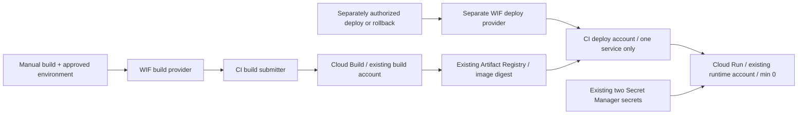

# Identifier Q infrastructure automation

Prepared on `prepare/cloud-run` for `quddha16-pixel/feint-iq`, project `feint-identifierq` (`334840153796`), `us-central1`. **No Google Cloud resource creation, Cloud Build execution, registry push, backend deployment, billing change or frontend publication has been performed by this automation assignment.** A production container was built and tested locally only. The founder reports the existing infrastructure/IAM is ready; the setup planner checks it again before proposing additions. This workspace has no gcloud executable or connected Google Cloud identity.

## Architecture and boundaries

| Option                                   | Assessment                                                                                                                                                       |
| ---------------------------------------- | ---------------------------------------------------------------------------------------------------------------------------------------------------------------- |
| Actions builds Docker directly           | Would duplicate the existing Cloud Build process and move image-build responsibility to GitHub. Not selected.                                                    |
| Cloud Shell starts Cloud Build           | Reuses the correct builder and is retained as a short-command fallback, but alone does not provide the requested Actions operation.                              |
| **Actions → WIF → existing Cloud Build** | **Selected.** Short-lived credentials, explicit manual execution, one Dockerfile/build definition, existing builder/runtime identities, immutable digest output. |

The workflows are `build-backend.yml` and `deploy-backend.yml`. Both accept **only workflow_dispatch**. There is no push/PR/workflow_run/schedule trigger. Quality checks run before Google authentication. Actions are pinned to upstream commit SHAs. Deployment is a separate operation; the build identity cannot deploy or read either secret. No workflow publishes Pages, invokes Gemini, or uploads footage.

The build uses `deploy/cloudrun/cloudbuild.yaml` and `server/Dockerfile`, with the existing `identifier-q-build` account. Tags contain the full source commit plus a unique nonce, avoiding replacement of prior build tags. **Tags are not claimed immutable**: the returned `sha256` digest is the deployment identity. The source commit is also an OCI image label. Build IDs, commit, image digest and outcome are in the Actions summary and a temporary local JSON record. Cloud Build has a 900-second execution limit. Cancellation attempts to cancel only that submitted build; a hard runner termination may leave it running until its own limit. There are no automatic build resubmissions. Check Console after ambiguous failures before rerunning.

Deployment accepts a successful Cloud Build ID plus its exact digest and enabled numeric secret versions. It verifies the dedicated builder, source bucket, source commit, digest, ancestor relationship and request-stream-v1 source before deployment. Rollback redeploys an earlier approved digest with the **current safe configuration**. It does not blindly restore old routing/configuration. It refuses unrelated service identities, sidecars and split/tagged traffic. Environment/secret updates preserve unrelated entries; IAM additions preserve existing bindings. No automatic rollback follows a failed probe because the service may already have changed.

**Least-privilege first deployment:** CI is deliberately not granted project-wide Run creation or administration. After separate deployment authorization, the project owner creates the service once with the guarded `first-deploy` helper in Cloud Shell. Then the deploy setup can grant the CI account update/IAM permissions on **only identifier-q-api**. Routine deployments and rollbacks use Actions. This one-time bootstrap avoids granting CI control over unrelated services.

## Exact Google trust

Repository IDs were read from GitHub's API: repository **1443546506**, owner **297506389**. One dedicated pool, `identifierq-github`, has two independently restricted providers:

| Provider        | Workflow                               | GitHub environment   | Impersonated service account                                       |
| --------------- | -------------------------------------- | -------------------- | ------------------------------------------------------------------ |
| `github-build`  | `.github/workflows/build-backend.yml`  | `identifierq-build`  | `identifier-q-ci-build@feint-identifierq.iam.gserviceaccount.com`  |
| `github-deploy` | `.github/workflows/deploy-backend.yml` | `identifierq-deploy` | `identifier-q-ci-deploy@feint-identifierq.iam.gserviceaccount.com` |

Each provider requires **all** of: those numeric repository/owner IDs, exact repository name, `refs/heads/prepare/cloud-run`, event `workflow_dispatch`, its exact `workflow_ref` at that branch, and the environment-specific subject `repo:quddha16-pixel/feint-iq:environment:identifierq-build` or `identifierq-deploy`. Issuer: `https://token.actions.githubusercontent.com`; default provider audience checks stay enabled. Forks, pull requests, alternate workflows and other branches do not qualify. Changing branch/workflow/ownership requires a separate trust review; setup refuses to overwrite an existing provider whose trust differs.

Both providers share a pool but map **different constant pipeline attributes** (`'build'` / `'deploy'`). The service-account Workload Identity User grant uses only its own `attribute.pipeline/build` or `/deploy` principal set. A build token cannot select the deploy account. No service-account JSON key or project-wide Token Creator is needed. The exact CEL/mapping/principal strings are emitted by the read-only planner.

Protect write access to the approved branch and review changes to the workflows, cloud scripts, Dockerfile, lockfile and build config. Required environment reviewers provide an additional human gate. Contributors with trusted-branch write and approval authority can change privileged code; WIF does not make malicious approved code safe. `cloudbuild.builds.create` is inherently powerful: an administrator must also review any legacy/default Cloud Build account and inherited/group permissions; do not leave an alternate default build identity with broad secret/Editor privileges. The planner checks direct grants on the named accounts and refuses mismatched roles/providers, but it is not an exhaustive inherited-IAM analyzer.

## Proposed additional resources and least-privilege grants

**No resources below have been created here. Apply requires explicit resource-creation approval.** Existing builder/runtime accounts, the private source bucket, repository and both secrets are reused; do not recreate them.

| Identity                                  | Scope / permissions                                                                                                                                                                                                                                                                                                                                                                                                                                                                                                  |
| ----------------------------------------- | -------------------------------------------------------------------------------------------------------------------------------------------------------------------------------------------------------------------------------------------------------------------------------------------------------------------------------------------------------------------------------------------------------------------------------------------------------------------------------------------------------------------- |
| Existing `identifier-q-build`             | Existing writer on the one Artifact Registry repository, object viewer on the one source bucket, project log writer. No new privileges are added by setup.                                                                                                                                                                                                                                                                                                                                                           |
| Existing `identifier-q-runtime`           | Existing accessor on **identifierq-gemini-api-key** and **identifierq-pilot-token** only. No new privileges are added.                                                                                                                                                                                                                                                                                                                                                                                               |
| New `identifier-q-ci-build`               | Project custom role `identifierQBuildSubmitter`: builds.create/get/update (submit, observe, cancel), projects.get, services.use. Account User on **only the existing builder**. Bucket-scoped `identifierQSourceUploader`: buckets.get and objects.create/get/list; no object delete, no access to other buckets. WIF User on this CI account for only the build pipeline.                                                                                                                                           |
| New `identifier-q-ci-deploy` — later only | Project custom role `identifierQRunDeployer`: builds.get, projects.get, operations.get, services.use. **No project-wide run.services permission**. Service-scoped `identifierQServiceDeployer`: services.get/update/getIamPolicy/setIamPolicy on **identifier-q-api**. Account User on **only runtime**. Repository reader on the existing image repository. `identifierQSecretVersionReader` on the two secrets: secrets.get/versions.get metadata, **not versions.access**. WIF User only for the deploy pipeline. |

Build setup proposes **one pool, one OIDC provider, one CI account, two custom roles and scoped bindings**, plus enabling IAM Credentials / STS APIs if missing (IAM itself is checked/enabled if needed). Future deployment setup adds **one provider, one CI account and three custom roles**, reusing that pool. It refuses to apply deployment grants until the dedicated service exists. IAM/WIF themselves add no warm compute, secret copies, queue or database. No new paid infrastructure is required for authentication. Custom roles avoid broad Editor, Run Admin, Storage Admin or Secret Accessor grants to CI.

The read-only planner inspects existing project/resource/account policies before any addition. Permission denied is an error, never treated as resource absence. Existing mismatched custom roles, unexpected pool providers, broad direct runtime/builder grants, public source-bucket bindings, wrong-service act-as grants and unexpected federated impersonators stop setup for administrator review. Apply is additive, idempotent for its exact matching resources, and never calls set-iam-policy, deletes resources, rotates secrets or replaces a provider. A partially failed apply can be inspected and rerun after its error is resolved.

The administrator running approved setup needs project read/IAM-policy administration, Workload Identity Pool Admin, Service Account Admin, custom Role Admin, Service Usage Admin if API enablement is missing, and authority to add scoped bucket/repository/secret/service policies. The existing project owner typically has these; do not grant broad administration to CI to perform setup.

## Financial and analytical restrictions

Every build dispatch requires confirming an **unupgraded Google Cloud Free Trial**, sufficient valid promotional credit/days and Gemini **Free Tier**. This is an operator confirmation: neither a model name nor `billingEnabled` proves the account's tier or balance. No code upgrades/links billing, buys prepaid credits, activates Vertex AI, chooses a paid-only model or adds a recurring schedule. Standard public-repository GitHub-hosted Ubuntu runners are used. No paid larger runners, artifact uploads or dependency-cache storage are requested. Build metadata/digests remain in the Actions summary and Cloud Build itself.

Cloud Build minutes, retained Artifact Registry images, source archives/storage operations, logs, Secret Manager accesses/versions and Cloud Run compute/transfer can consume eligible promotional credits above shared free allowances. WIF/service accounts/custom IAM roles do not create permanent compute charges. **Zero personal spending remains conditional on keeping the account an unupgraded Free Trial and Gemini Free Tier; this is not a hard spending cap implemented by code.** Alerts and max instances do not cap spending. Google states trial exhaustion/expiration can stop resources: do not upgrade to avoid an outage. The $300 Cloud credit **cannot pay Gemini API in AI Studio charges**. Inference remains quota-limited Free Tier only; no inference is performed by this assignment.

Cloud Run settings remain us-central1, gen2, 1 vCPU / 2 GiB, service and revision minimum 0 / maximum 1, request-based throttled CPU, no startup CPU boost, 600-second request timeout and HTTP concurrency 8. The application still limits heavy analyses to one at a time. Upload limit is 25 MiB / 10–300 seconds; CORS is `https://quddha16-pixel.github.io`. Runtime secret names and backend variables stay unchanged. Secret **version numbers** are workflow inputs, never secret values. Source archives reject env/key files, short-lived `gha-creds-*.json`, footage and escaping symlinks. Credential files are ignored by Git, Cloud Build and Docker. Neither CI identity has secret-payload access.

The only automated live checks after a future authorized deployment are GET /livez, unauthenticated GET /health (must return app 401), allowed-origin OPTIONS and rejection of an unexpected origin. No token is read or footage sent. Owner-only authenticated health/protocol checks and the consented clip evaluation remain separate launch steps. Gemini model `gemini-3.5-flash-lite`, source-frame evidence, fighter metadata, null scores, cancellation/timeouts and Free Tier quota failure handling are preserved. A runtime dependency audit found GHSA-mrhx-c7xc-m3w5 in Zod 3.25.76. Zod was updated to patched 4.6.7; Vitest was updated to 4.1.12 to remove critical worker-pool and compatible mocker advisories; the only product-source adjustment is the matching generic type in the browser-storage helper. Report/configuration schemas and product behavior are retained and regression-tested.

## Smallest founder steps from iPhone

Use the [short phone/Cloud Shell guide](PHONE.md). Nothing runs automatically when it opens.

1. **Read-only cloud plan:** open the linked Cloud Shell checkout and run `bash deploy/cloudrun/iq setup`. It checks existing metadata/IAM and prints the precise non-secret trust/permission plan. No keys in chat or terminal input.
2. **After approving the additional WIF resources:** run `bash deploy/cloudrun/iq setup --approve-wif-setup` once as project owner. It creates only the build-side authentication resources/grants described above, not a container build or deployment. Deployment setup remains separate and unapproved.
3. **GitHub settings:** Settings → Environments → New environment → `identifierq-build`. Add the founder as required reviewer and restrict deployment branches/tags to the branch `prepare/cloud-run`. Keep self-review allowed if the sole founder must approve their own manually dispatched run; do not enable protection bypass for other contributors. Settings → Secrets and variables → Actions → **Variables** → add non-secret `IDENTIFIERQ_BUILD_ENABLED=true` **only after** the setup is verified. Do not add Gemini/pilot secrets to GitHub. Keep `IDENTIFIERQ_DEPLOY_ENABLED` absent/false; do not create deploy-side trust yet.
4. **Workflow discovery needs separate main-update authorization.** GitHub requires workflow_dispatch files on the repository's default branch (`main`). They are currently only on the preparation branch. Do not merge the complete branch or change the default branch. A later authorized installation can put **only the two workflow YAML files** on main, with a `[skip ci]` commit to suppress its push-triggered Pages workflow. This does not publish the new frontend. This step is **not performed or authorized here**. See [GitHub dispatch behavior](https://docs.github.com/actions/using-workflows/events-that-trigger-workflows#workflow_dispatch) and [skip behavior](https://docs.github.com/actions/managing-workflow-runs/skipping-workflow-runs). Do not use an ordinary main push that would publish Pages.
5. **First/routine build:** once discoverable, Actions → **Build Identifier Q backend** → Run workflow → select **prepare/cloud-run** → confirm trial-only use → Run → approve `identifierq-build`. Read the successful Cloud Build ID and digest in the summary. **This does not deploy.** The founder already authorized the first eligible-credit build; it has not run because authentication/default-branch registration remain incomplete. If those GitHub steps are deferred, the same approved Cloud Build can be initiated from the owner's existing secure Cloud Shell login with `bash deploy/cloudrun/iq build --approve-trial-build`, without WIF or default-branch publication. Confirm trial credit/days first. This fallback creates no extra authentication resources and uses the same build definition/guards.

**Later, only after explicit backend deployment authorization:** the owner runs `bash deploy/cloudrun/iq first-deploy --approve-deployment`. It requires typing DEPLOY and TRIAL and prompts only for the successful build UUID, digest and numeric secret versions, never keys/tokens. It uses the same deployment code to create only the dedicated service; no broad CI role is needed. Then inspect a deploy-side plan with `bash deploy/cloudrun/iq setup --purpose deploy`; approve its scoped additions separately with `--approve-wif-setup`. Create protected `identifierq-deploy` in GitHub, restrict it to the same branch, add a required reviewer, and only then set `IDENTIFIERQ_DEPLOY_ENABLED=true`. Routine Actions deployments/rollbacks choose operation, approved build ID/digest, numeric versions, type DEPLOY/ROLLBACK and confirm trial-only use; approve the environment. If policy forbids public invocation, stop instead of bypassing it.

**Frontend compatibility remains a separate approval:** the preparation branch's client/server use request-stream-v1. Public Pages still uses the older transport; do not connect it to this backend until the reviewed frontend update is separately published. Existing Pages remains functional and unmodified by these changes.

## Current verification limits

Local test results are recorded in [docs/VALIDATION.md](../../docs/VALIDATION.md). Cloud commands are tested against synthetic metadata/command contracts, not represented as successful Google operations. The read-only planner on this machine stops because gcloud is unavailable. GitHub's environment list currently shows only `github-pages`; repository-variable inspection returns **403 Resource not accessible by integration**. No GitHub settings were changed. The owner must configure the new environments/variables in Settings, or provide an appropriately scoped GitHub integration; no API key or service-account credential should be pasted in chat.

The existing Pages workflow, Vite base path, application/backend behavior, fighter/report contracts and local-history behavior remain intact. No build/deploy workflow has been dispatched. Physical iPhone Safari, actual federation/permissions, Google Cloud Build output, Cloud Run proxy behavior, live Gemini access and real-footage quality are still unverified.

## Validation recorded for this change

- Type checking and ESLint passed. **59 application/backend tests** and **32 offline infrastructure/security tests** passed. The infrastructure tests use synthetic Cloud responses and never call Google APIs.
- All **23 Chromium browser regressions** passed with one worker and the original 30-second test deadlines. The initial concurrent run timed out in the multi-page accessibility scan while Docker was building; it passed in 10.9 seconds on the serial rerun, with no assertions disabled or timeouts increased. Physical iPhone Safari was not tested.
- Production build and built-site Chromium smoke passed: repository base path, HTML/JS/CSS, new analysis, history, report, settings, About, hash navigation and reload, without JavaScript errors. Rollup emitted two harmless annotation-comment warnings from upstream Zod; it removed those comments.
- Production Docker build passed with production dependencies. A local 1 CPU / 2 GiB container passed non-root execution, injected PORT=9090, FFmpeg/ffprobe, minimal public health, protected detailed health, exact Pages CORS, request-stream-v1 and 25 MiB/10–300-second limits. It had no real provider key and invoked no model.
- Actionlint 1.7.7 (pinned archive checksum), YAML/security invariants, Python Ruff checks/format, shell syntax and credential ignore/bundle checks passed. These validate repository code, not live WIF/Cloud Build permissions.
- Runtime dependency audit: **0 findings** after the Zod fix. Full audit after Vitest 4.1.12: **0 critical, 0 high, 11 moderate development-only dependency findings**, all stemming from Minimatch's glob amplification advisory [GHSA-g3hv-75wg-m249](https://github.com/advisories/GHSA-g3hv-75wg-m249) in the ESLint/type-aware lint chain. No incompatible override or ESLint downgrade was forced. CI blocks high/critical advisories; this remaining upstream lint dependency issue is documented, not marked fixed.
- No actual federation token exchange, Cloud Build execution, Artifact Registry push, Cloud Run deployment or live Gemini call was tested. The owner's cloud preflight/setup and actual first build remain pending. Main and the Pages workflow are unchanged.
